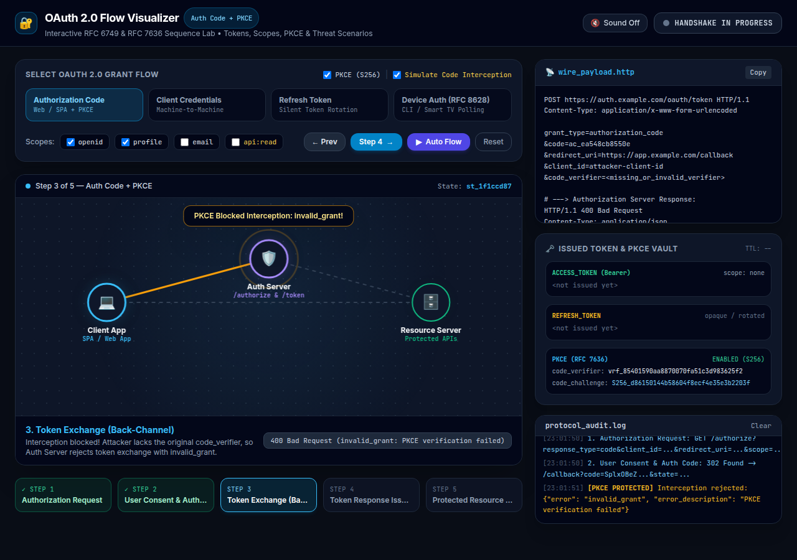
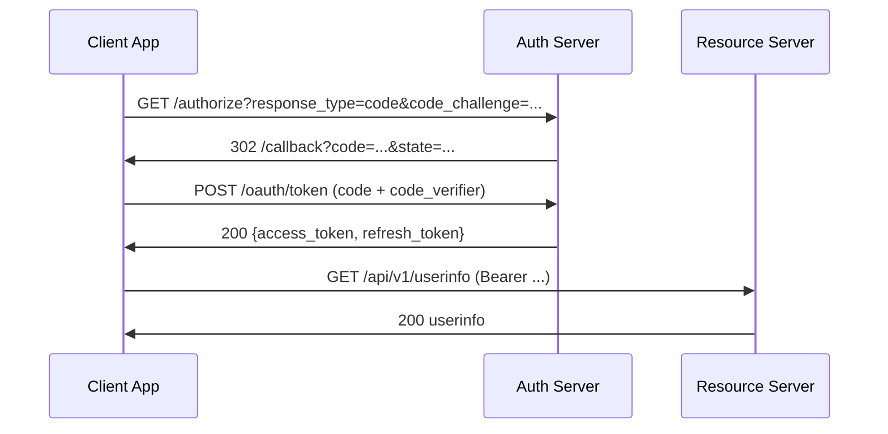

# OAuth 2.0 Flow Visualizer

An interactive protocol lab for OAuth 2.0 ([RFC 6749](https://www.rfc-editor.org/rfc/rfc6749)) and PKCE ([RFC 7636](https://www.rfc-editor.org/rfc/rfc7636)). Step through four grant flows as animated packets travel between the client, the authorization server, and the resource server — with live wire payloads, issued tokens, and a code-interception attack simulation that shows exactly what PKCE protects.



## Grant flows

- **Authorization Code + PKCE** — web / SPA apps. Redirect, user consent, single-use authorization code, back-channel token exchange with `code_verifier`, then a protected resource call.
- **Client Credentials** — machine-to-machine. Service authenticates with `client_id` and `client_secret`, receives a machine-scoped access token (no refresh token), and reuses it from cache until expiry.
- **Refresh Token** — silent rotation. An expired access token triggers a refresh grant; the server issues a fresh pair and rotates the refresh token, with reuse detection that revokes the whole token family on replay.
- **Device Authorization Grant (RFC 8628)** — CLI / smart TV. Device requests a `device_code` and `user_code`, displays the verification URI, and polls `/oauth/token` until the user approves on a separate device.

## Features

- Animated packet routing on an HTML5 canvas (client ↔ auth server ↔ resource server), with ripples, trails, and per-step beams
- Live wire payload inspector — query parameters, `application/x-www-form-urlencoded` bodies, PKCE challenges, and JSON token responses, with a copy button
- Issued token & PKCE vault — access token (Bearer), refresh token, `code_verifier` / `code_challenge` (S256), scope badge, TTL
- Protocol audit log with timestamps (capped at 150 lines)
- Scope configurator (`openid`, `profile`, `email`, `api:read`) — scopes flow into the payloads and the token
- PKCE (S256) toggle and a **code-interception attack simulation**: arm it with PKCE on and the exchange fails with `invalid_grant` (PKCE verification failed); arm it with PKCE off and the stolen code is redeemed with a security warning
- Step-by-step navigation (Next / Prev / stepper pills), Auto Flow, and Reset
- Procedural sound effects (Web Audio, off by default) and reduced-motion support
- Frame-rate independent animation, bounded log, zero-dependency engine beyond the CDN styling

## Try the attack

1. Select **Authorization Code** and check **Simulate Code Interception** (PKCE on).
2. Step to **3. Token Exchange** — the attacker lacks the `code_verifier`, so the server answers `400 Bad Request` with `invalid_grant`.
3. Uncheck **PKCE (S256)** and run it again — without PKCE the intercepted code is redeemed and the log raises a security warning.

## Run it

No build step. The visualizer is a single static file (`index.html`) plus its CDN dependencies (Tailwind CSS, Google Fonts), so it needs internet access for full styling.

**Open it directly** — double-click `index.html`, or serve it locally:

```bash
python3 -m http.server 8000
# then open http://localhost:8000
```

**GitHub Pages** — push this folder to a repository, then in the repo go to Settings → Pages → Build and deployment → Deploy from a branch → select the branch and `/ (root)` → Save. The visualizer is live at `https://<username>.github.io/<repo>/` within a minute or two.

## How it works



Each flow is a five-step script: the stepper, the canvas beam, the wire payload, the token vault, and the audit log all advance together from the same step definition. Tokens are generated locally in the browser (`crypto.getRandomValues`) — no real credentials, no backend, no network calls to any authorization server. Everything shown is simulated.

## Project layout

```text
index.html                  The visualizer (single file)
index.original.html         The original file, before polishing
LICENSE                     MIT
README.md                   This file
POLISH-NOTES.md             What changed during polishing, and why
playtest.js                 Headless-Chromium playtest (72 checks)
shots/                      Screenshots (styled + headless captures)
```

## Browser testing

| Browser | Status |
| --- | --- |
| Chrome (desktop) | Tested — full playtest passes (all 4 flows, PKCE on/off, attack sim, reset, auto flow) |
| Edge (desktop) | Shares the Chromium engine with Chrome — not run separately |
| Firefox (desktop) | Not tested yet |
| Mobile Safari | Not tested yet |

## Credits

- [Tailwind CSS](https://tailwindcss.com/) — styling
- [RFC 6749 — The OAuth 2.0 Authorization Framework](https://www.rfc-editor.org/rfc/rfc6749)
- [RFC 7636 — Proof Key for Code Exchange (PKCE)](https://www.rfc-editor.org/rfc/rfc7636)
- [RFC 8628 — OAuth 2.0 Device Authorization Grant](https://www.rfc-editor.org/rfc/rfc8628)
- Fonts: Inter and JetBrains Mono (Google Fonts)

## License

MIT — see [LICENSE](LICENSE).
